<div align="center">


# Herbarium

**Chaque candidature de stage, notée et classée.**
*Every internship application, logged and filed.*

Suivez vos candidatures, le CV envoyé à chacune, vos relances, et apprenez de chaque réponse.
Chaque candidature devient un spécimen d'herbier : une plante peinte à l'aquarelle qui pousse avec elle.

[**Ouvrir Herbarium**](https://herbarium-eta.vercel.app) · [Guide d'utilisation](#guide-dutilisation) · [Lancer en local](#lancer-en-local) · [Contribuer](#contribuer)

[](https://github.com/Musmus05/herbarium/actions/workflows/ci.yml)


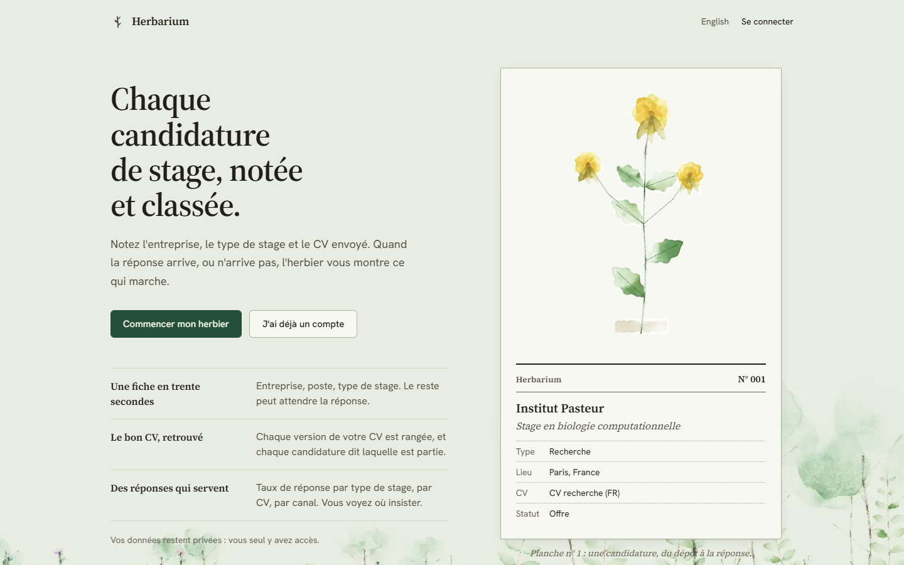

</div>

---

## Sommaire

- [Une plante qui pousse avec votre candidature](#une-plante-qui-pousse-avec-votre-candidature)
- [Ce que fait Herbarium](#ce-que-fait-herbarium)
- [Guide d'utilisation](#guide-dutilisation)
  - [1. Créer un compte](#1-créer-un-compte)
  - [2. Ranger vos CV](#2-ranger-vos-cv)
  - [3. Ajouter une candidature](#3-ajouter-une-candidature)
  - [4. Retrouver et filtrer vos candidatures](#4-retrouver-et-filtrer-vos-candidatures)
  - [5. Mettre à jour une candidature](#5-mettre-à-jour-une-candidature)
  - [6. Supprimer une candidature ou un CV](#6-supprimer-une-candidature-ou-un-cv)
  - [7. Lire votre vue d'ensemble](#7-lire-votre-vue-densemble)
  - [8. Votre profil et vos données](#8-votre-profil-et-vos-données)
- [Lancer en local](#lancer-en-local)
- [Architecture](#architecture)
- [Les peintures : comment ça marche](#les-peintures--comment-ça-marche)
- [Mettre en production](#mettre-en-production)
- [Contribuer](#contribuer)

---

## Une plante qui pousse avec votre candidature

Chaque candidature reçoit une plante peinte avec [p5.brush](https://github.com/acamposuribe/p5.brush), une bibliothèque de pinceaux naturels : traits de crayon, lavis d'aquarelle qui débordent, texture du papier. La plante se peint sous vos yeux, trait par trait : la tige monte, les feuilles se posent, puis la fleur s'ouvre.

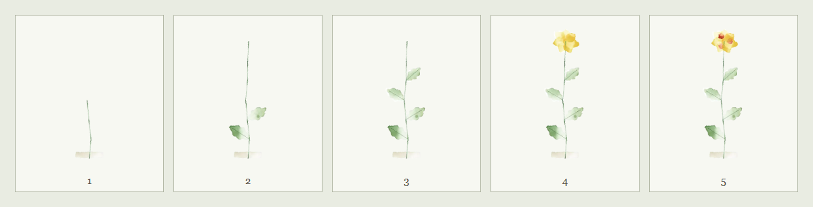

**Son stade de croissance raconte où en est la candidature :**

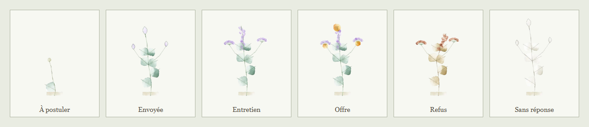

| Statut de la candidature | La plante |
|---|---|
| À postuler | une graine qui germe |
| Envoyée, Relancée | des bourgeons fermés |
| Entretien | les fleurs s'ouvrent |
| Offre | fleurs et fruits |
| Refus | la plante fane et brunit |
| Sans réponse, Abandonnée | la plante pâlit |

**Aucune plante ne se ressemble.** Chaque plante a un génome tiré de l'identifiant de sa candidature : port (tige simple, ramifiée, rosette), forme de feuille (lancéolée, ronde, étroite, lobée, composée), disposition (alterne, opposée, verticillée), fleur (pétales, marguerite, clochette, épi, grappe, double), dix couleurs de pétales, trois types de fruits. Cela fait des milliers de combinaisons.

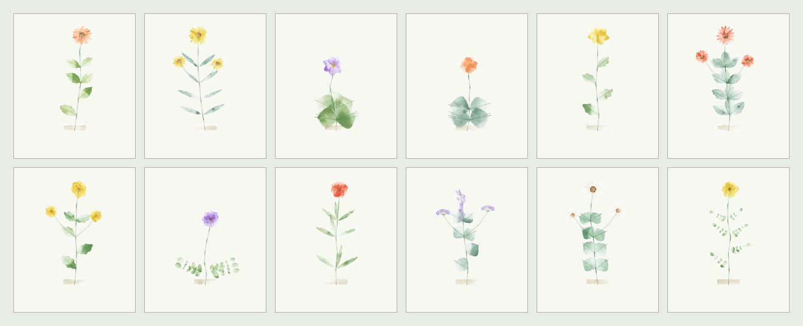

---

## Ce que fait Herbarium

| | |
|---|---|
| **Une fiche en trente secondes** | Entreprise, poste, type de stage. Le reste (canal, lieu, contact, dates) peut attendre. |
| **Le bon CV, retrouvé** | Chaque version de votre CV est rangée en PDF, et chaque candidature dit laquelle est partie. |
| **Des relances à l'heure** | La date de relance est proposée 10 jours après l'envoi ; les relances en retard remontent en rouge. |
| **Des réponses qui servent** | Taux de réponse par type de stage, par CV et par canal, délai de réponse médian, et une phrase « à retenir ». |
| **Privé par défaut** | Chaque compte ne voit que ses propres données (Row Level Security). Export JSON et suppression du compte en un clic. |
| **Bilingue** | Interface en français et en anglais. |

---

## Guide d'utilisation

> Pour essayer sans rien créer, connectez-vous sur [herbarium-eta.vercel.app](https://herbarium-eta.vercel.app/login) avec le compte de démonstration `demo@herbarium.test` / `demo-herbarium-2026` (17 candidatures fictives). Ce compte est partagé : ses données reviennent aux exemples toutes les heures, et photo, e-mail, mot de passe et suppression y sont désactivés.

### 1. Créer un compte

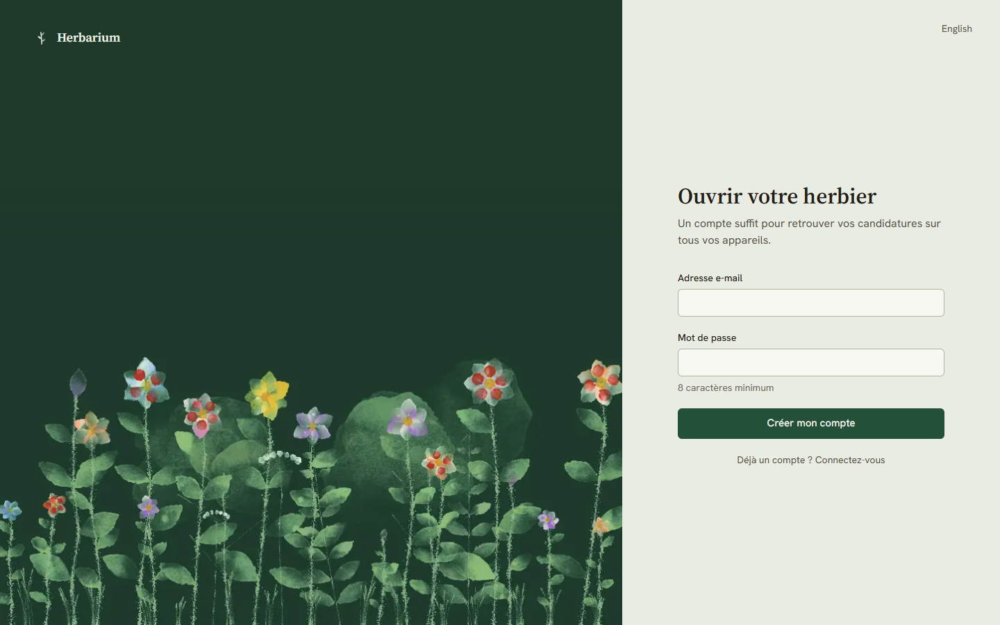

1. Sur la page d'accueil, cliquez **Commencer mon herbier**.
2. Entrez votre e-mail et un mot de passe de 8 caractères minimum, puis **Créer mon compte**.
3. Si une confirmation est demandée, ouvrez l'e-mail reçu et cliquez sur le lien.

Vous préférez ne pas retenir de mot de passe ? Sur **Se connecter**, choisissez **Recevoir un lien de connexion par e-mail**.

### 2. Ranger vos CV

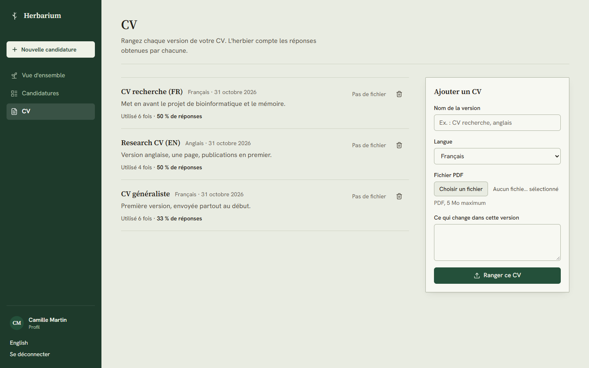

Rangez vos CV avant d'ajouter des candidatures, pour pouvoir dire lequel est parti.

1. Menu **CV**.
2. Dans **Ajouter un CV** : donnez un nom de version (« CV recherche (FR) », « Research CV (EN) »), la langue, le fichier PDF (5 Mo maximum) et ce qui change dans cette version.
3. **Ranger ce CV**.

Chaque version affiche ensuite combien de fois elle a été envoyée et son taux de réponse. **Ouvrir le PDF** génère un lien sécurisé valable une minute.

### 3. Ajouter une candidature

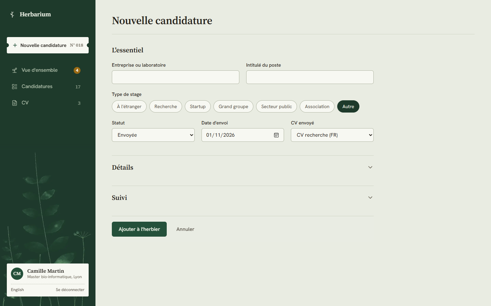

1. Cliquez **Nouvelle candidature** (en haut de la barre latérale, ou sur la vue d'ensemble).
2. Remplissez **l'essentiel** :
   - **Entreprise ou laboratoire** et **intitulé du poste** (obligatoires) ;
   - **Type de stage** : à l'étranger, recherche, startup, grand groupe, secteur public, association, autre ;
   - **Statut** (« Envoyée » par défaut), **date d'envoi** (aujourd'hui par défaut) et **CV envoyé**.
3. Si vous voulez, dépliez **Détails** (canal, lien vers l'offre, ville, pays, contact, début et durée du stage) et **Suivi** (date de relance, notes, retour reçu).
4. **Ajouter à l'herbier**. La fiche s'ouvre, avec son numéro d'accession et sa plante.

> La date de relance se remplit seule, 10 jours après la date d'envoi. Modifiez-la si vous préférez une autre date ; elle ne sera plus recalculée.

### 4. Retrouver et filtrer vos candidatures

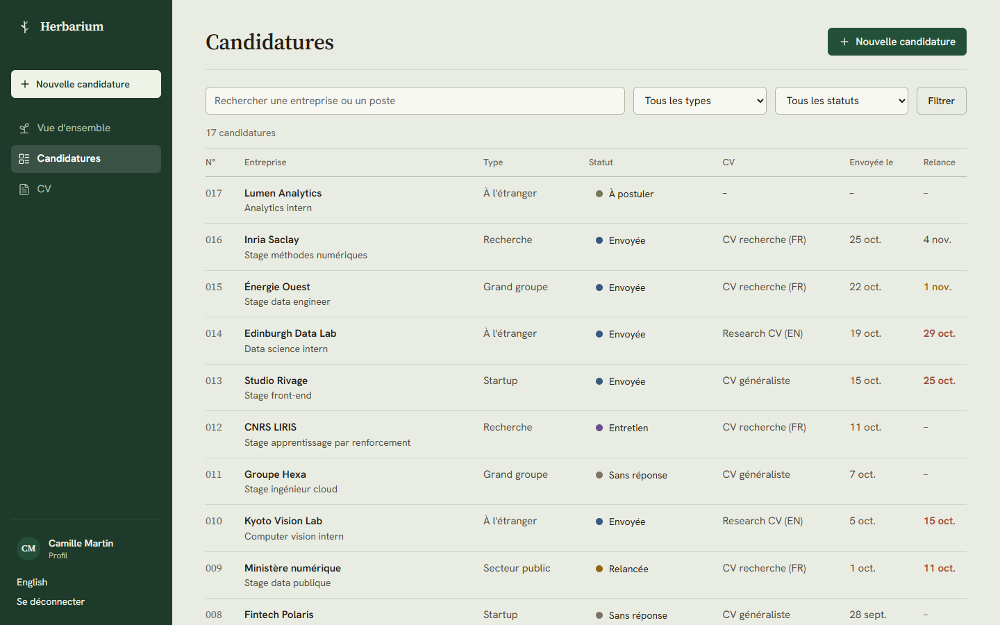

Menu **Candidatures** :

- **Rechercher** une entreprise ou un poste dans la barre du haut ;
- **Filtrer** par type de stage et par statut, puis **Filtrer** ; **Effacer les filtres** pour tout revoir ;
- la colonne **Relance** passe en ocre deux jours avant l'échéance, en rouge quand elle est dépassée ;
- cliquez sur une entreprise pour ouvrir sa fiche.

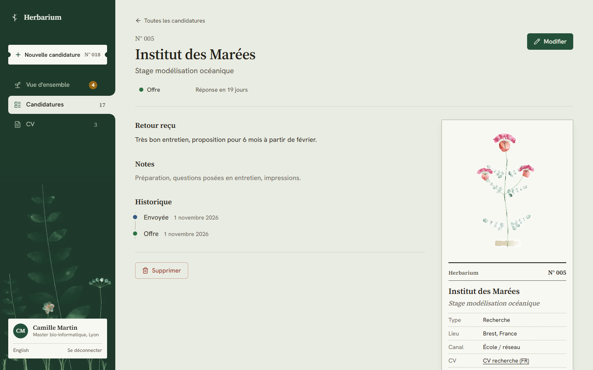

La fiche montre le retour reçu, vos notes, le contact, l'**historique** de chaque changement de statut et l'étiquette d'herbier avec toutes les informations.

### 5. Mettre à jour une candidature

**Changer le statut (le plus fréquent)** : directement dans la liste ou en haut de la fiche, ouvrez le menu du statut et choisissez le nouveau. C'est enregistré tout de suite, ajouté à l'historique, et la plante change de stade.

> Quand une candidature passe à Entretien, Offre ou Refus, la date de réponse est remplie automatiquement (si elle était vide) : c'est elle qui alimente le délai de réponse médian.

**Modifier tout le reste** : sur la fiche, cliquez **Modifier**.

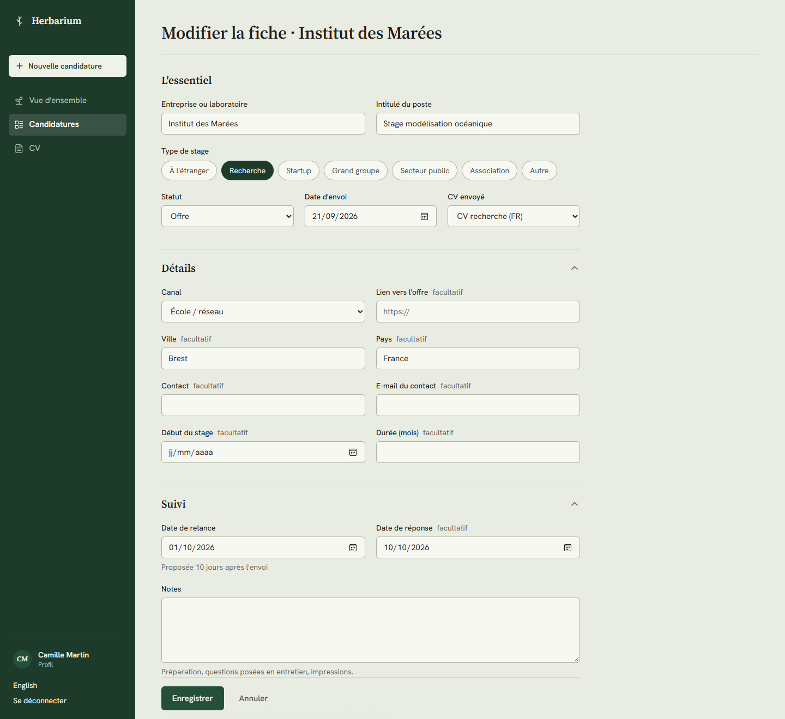

Changez ce qu'il faut puis **Enregistrer**. Pensez surtout à :

- **Date de relance** quand vous avez relancé (et passez le statut à « Relancée ») ;
- **Retour reçu** : ce que l'entreprise vous a dit. C'est ce qui vous aide le plus à progresser ;
- **Notes** : préparation, questions posées en entretien, impressions.

### 6. Supprimer une candidature ou un CV

- **Une candidature** : sur sa fiche, **Supprimer**, puis confirmez. La suppression est définitive.
- **Un CV** : menu **CV**, icône corbeille à droite de la version, puis confirmez. Le fichier est effacé ; les candidatures qui l'utilisaient restent, sans CV associé.

### 7. Lire votre vue d'ensemble

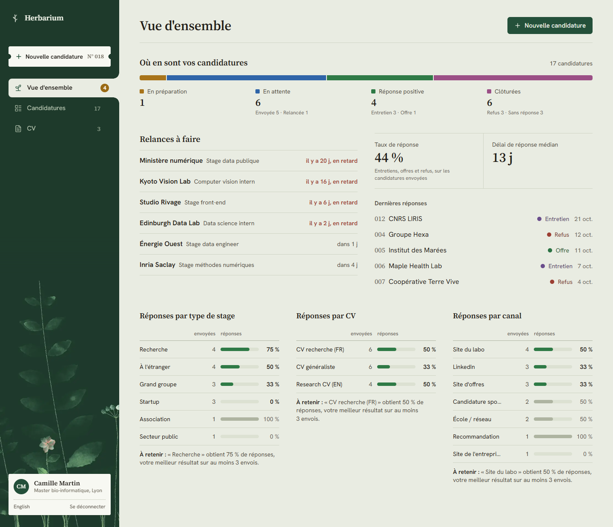

- **Où en sont vos candidatures** : en préparation, en attente, réponse positive, clôturées ;
- **Relances à faire** : celles des 7 prochains jours et celles en retard ;
- **Taux de réponse** : entretiens, offres et refus, sur les candidatures envoyées ;
- **Délai de réponse médian** entre l'envoi et la réponse ;
- **Réponses par type de stage, par CV et par canal**, avec une phrase **À retenir** : la catégorie qui marche le mieux, ou celle qui ne reçoit aucune réponse. Les barres grises indiquent moins de 3 envois : pas encore assez pour conclure.

<p align="center">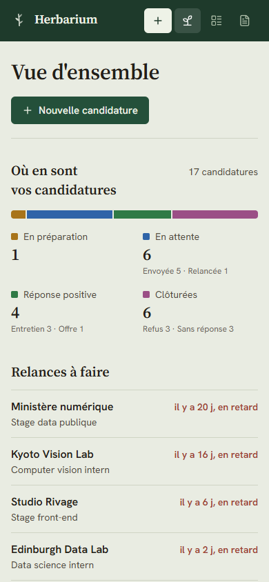</p>

### 8. Votre profil et vos données

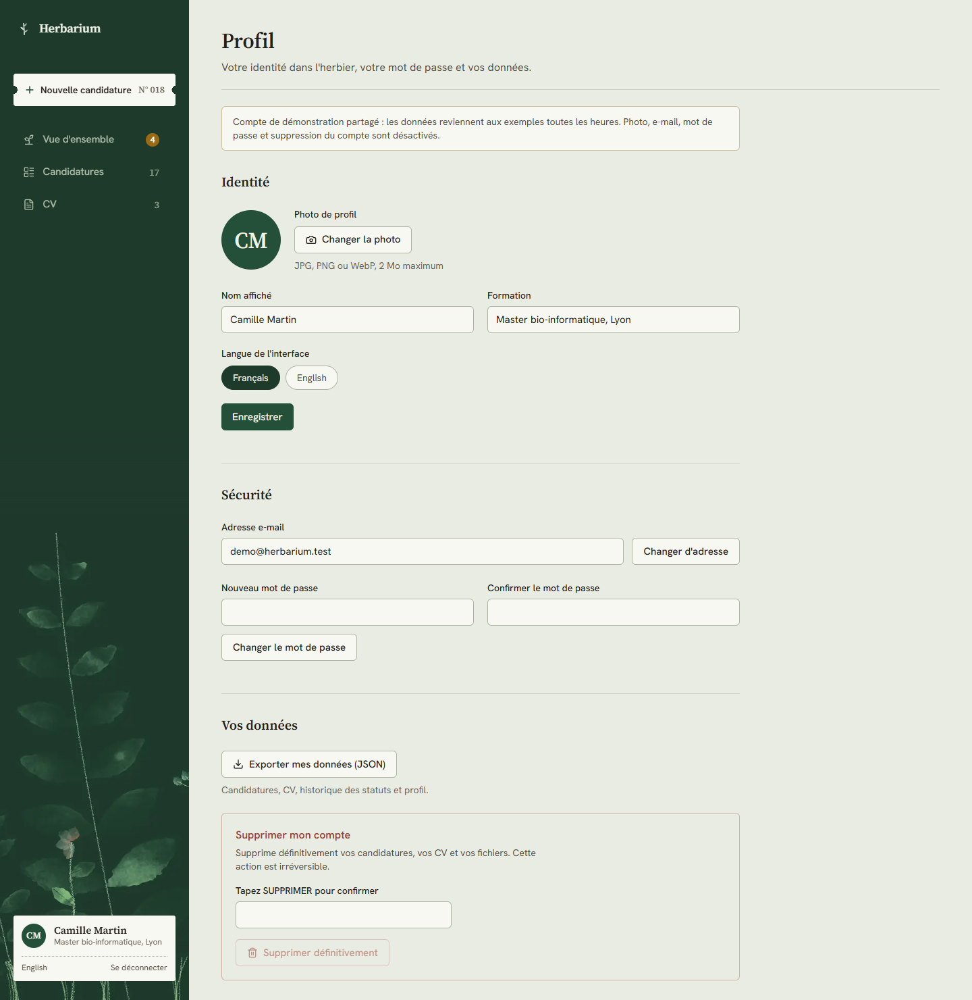

Cliquez sur votre nom en bas de la barre latérale.

| Action | Comment |
|---|---|
| Photo de profil | **Changer la photo** (JPG, PNG ou WebP, 2 Mo). Elle reste privée. |
| Nom, formation, langue | Modifiez puis **Enregistrer**. |
| Changer d'e-mail | Nouvelle adresse, **Changer d'adresse**, puis confirmez depuis l'e-mail reçu. |
| Changer de mot de passe | Nouveau mot de passe deux fois, **Changer le mot de passe**. |
| Exporter vos données | **Exporter mes données (JSON)** : candidatures, CV, historique et profil. |
| Supprimer votre compte | Tapez `SUPPRIMER`, puis **Supprimer définitivement**. Tout est effacé, fichiers compris. |

---

## Lancer en local

**Prérequis** : Node.js 22+, Docker Desktop (pour Supabase en local).

```bash
git clone https://github.com/Musmus05/herbarium.git
cd herbarium
npm install
npx supabase start            # Postgres, Auth et Storage dans Docker
cp .env.example .env.local    # collez l'API URL et la clé « Publishable » affichées
npm run dev
```

Ouvrez http://localhost:3000 et connectez-vous avec le compte de démonstration (le même qu'en ligne, créé par la migration [`20261101120000_demo_account.sql`](supabase/migrations/20261101120000_demo_account.sql)) :

| E-mail | Mot de passe |
|---|---|
| `demo@herbarium.test` | `demo-herbarium-2026` |

Les e-mails locaux (confirmation, lien magique) arrivent dans Mailpit : http://127.0.0.1:54324.

| Commande | Effet |
|---|---|
| `npm run dev` | serveur de développement |
| `npm run lint` | ESLint |
| `npm run typecheck` | types des routes Next puis TypeScript |
| `npm run build` | build de production |
| `npx supabase db reset` | recrée la base locale avec migrations et données de démo |
| `npm run db:types` | régénère `src/lib/supabase/types.ts` |
| `node scripts/screenshots.mjs` | refait les captures et planches de ce README |

> `npx supabase db reset` efface la base locale et recrée le compte de démo : les sessions ouvertes sont déconnectées, reconnectez-vous simplement.

---

## Architecture

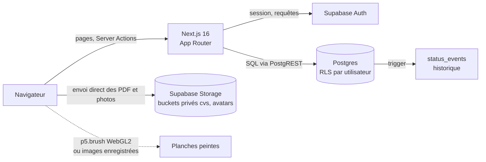

| Dossier | Contenu |
|---|---|
| `src/app` | routes : accueil, connexion, `/app` (vue d'ensemble, candidatures, CV, profil) |
| `src/components/brush` | botanique, génome des spécimens, scènes, peintre en direct, catalogue des images |
| `src/lib` | domaine, statistiques, dates, dictionnaires FR/EN, clients Supabase |
| `supabase/migrations` | schéma SQL, RLS, stockage, suppression de compte |
| `public/frames` | peintures enregistrées (lecture dans Firefox) |
| `PRODUCT.md`, `DESIGN.md` | ce que fait le produit, et son système visuel |

**Modèle de données** : `applications` (numéro d'accession par utilisateur, statut, type, canal, dates, CV, contact, notes, retour), `cvs` (versions et fichier PDF), `status_events` (historique écrit par trigger), `profiles` (nom, formation, langue, photo). Toutes les tables sont protégées par Row Level Security : un utilisateur ne lit et n'écrit que ses lignes.

---

## Les peintures : comment ça marche

Les plantes sont décrites comme une suite de traits datés (`src/components/brush/botany.ts`, `specimen.ts`, `scenes.ts`) puis peintes de deux façons selon le navigateur :

| Mode | Navigateurs | Ce qui se passe |
|---|---|---|
| **En direct** | Chrome, Edge, Safari | p5.brush peint chaque trait dans votre navigateur (WebGL2). Plante unique pour chaque candidature. |
| **Enregistré** | Firefox, ou tout navigateur où p5.brush a mis plus de 1,5 s à démarrer | Firefox recompile les shaders de p5.brush à chaque chargement (environ 20 s sous Windows). Il lit donc des images WebP enregistrées en développement, enchaînées avec des fondus : même rendu, démarrage immédiat, 24 variantes par stade. |

**Modifier les dessins** : changez `src/components/brush/`, lancez `npm run dev`, ouvrez http://localhost:3000/dev/frames et cliquez **Record all**. Les images sont réécrites dans `public/frames`. Cette page n'existe qu'en développement.

Le système visuel complet (couleurs, typographie, règles) est décrit dans [DESIGN.md](DESIGN.md).

---

## Mettre en production

1. Créez un projet sur [supabase.com](https://supabase.com), puis appliquez les migrations :
   ```bash
   npx supabase login
   npx supabase link --project-ref <votre-project-ref>
   npx supabase db push
   ```
2. Dans **Authentication > URL Configuration** : Site URL = votre domaine, et ajoutez `https://<domaine>/**` aux Redirect URLs.
3. Importez le dépôt sur [Vercel](https://vercel.com/new) avec deux variables :
   `NEXT_PUBLIC_SUPABASE_URL` et `NEXT_PUBLIC_SUPABASE_PUBLISHABLE_KEY`.

Chaque fusion sur `main` redéploie le site ; chaque Pull Request a son URL d'aperçu.

---

## Contribuer

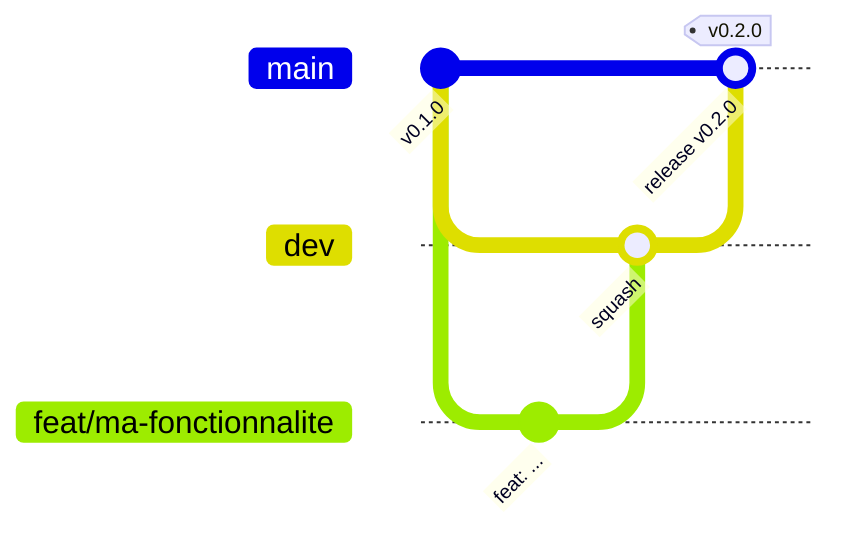

- `main` : production, protégée (PR et CI obligatoires) ;
- `dev` : intégration, protégée ;
- `feat/…`, `fix/…`, `docs/…` : une tâche, partie de `dev`, fusionnée en squash.

Commits en [Conventional Commits](https://www.conventionalcommits.org/fr/). Avant une PR : `npm run lint && npm run typecheck && npm run build`. Tout texte visible passe par `src/lib/i18n/dictionaries.ts`, en français et en anglais. Détails dans [CONTRIBUTING.md](CONTRIBUTING.md).

---

<div align="center">

[MIT](LICENSE) · Fait avec Next.js, Supabase et [p5.brush](https://github.com/acamposuribe/p5.brush) d'Alejandro Campos

</div>
